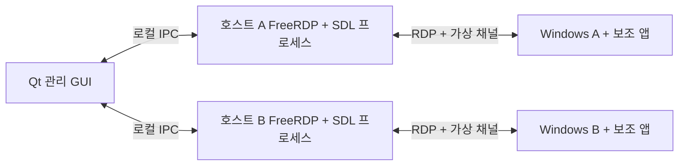
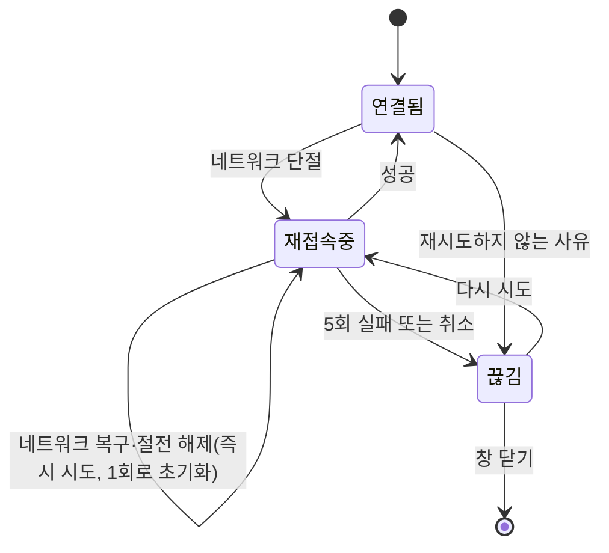

# WayWin 기획·설계

## 목표와 승인

Windows 11의 **접속한 RDP 사용자 세션**에 존재하는 창과 새 창을 Ubuntu의 개별 창으로 조작한다. 창 정지·충돌 방지, 장애 발생 시 다른 연결과 작업 보호가 최우선이다. 물리 콘솔의 동시 화면 공유는 요구하지 않는다.

2026-11-13 사용자가 이전 기획을 개발 의도로 지정하고 구현을 요청했다. 같은 세션에서 실제 Ubuntu/Windows에 지금 접근할 수 없으므로 **검증 도구와 절차 준비**를 선택했다. 실제 환경 증거가 없는 동안 0단계 진행 조건은 충족되지 않는다. 이 조건은 기능 요구 축소를 뜻하지 않는다.

후속 사용자 설명: 실제 작업표시줄이 필요한 목적은 시작 메뉴·IME 설정·빠른 설정이다. **작업표시줄 전체를 전송하지 못하더라도 각 Windows 원본 UI를 별도로 미러링하고 조작할 수 있어야 한다.** 단순 앱 목록·설정 바로가기·데스크톱 모드 안내만으로 이 요구를 충족했다고 판정하지 않는다. 호스트 또는 클라이언트가 멀티모니터인 경우도 재검증하도록 요청했다.

## 개발 순서 변경 (2026-11-14)

사용자가 “제품 구현해. 실환경 검증도 파이썬 스크립트 대신 실 제품에서 실행할 수 있도록 gui까지 완성시켜”라고 지시했다. 제품 기능 구현과 실환경 검증을 병행한다. 아래의 과거 0단계 선행 조건은 제품 구현을 막는 조건으로 더 이상 적용하지 않는다. R1–R7, 실환경 검증 항목과 출시 합격 기준은 유지한다. 구현·자동 검사·실환경 관측은 별도로 기록한다. 현재 상태와 사용 절차는 `docs/product.md`를 따른다.

## 요구사항

| ID | 첫 제품의 요구사항 |
|---|---|
| R1 | GUI 호스트 추가·수정·삭제, 접속·해제, 사용자명·인증 도메인·비밀번호, 화질·해상도 설정 |
| R2 | IP·DNS·포트·RDP 주소 입력. 서버 주소와 인증 도메인 구분 |
| R3 | 접속 전/후 창을 개별 창으로 표시. 입력·크기·최소화·복원·종료 연동 |
| R4 | 호스트별 창 목록·Windows 트레이 목록과 조작, 시작·실행 진입점. 원본 시작 메뉴·IME 설정·빠른 설정 UI의 개별 미러링과 조작 |
| R5 | 전체 데스크톱↔심리스 전환 중 같은 세션의 앱·작업 보존 |
| R6 | 동시 다중 호스트의 창·입력·클립보드·장애 격리 |
| R7 | 연결 실패·끊김·보조 앱 미설치·미지원 기능을 GUI로 설명하고 복구 제공 |

후속: 데스크톱과 선택 창의 혼합·중복 표시, Windows 원본 작업표시줄 전체 전송, 세밀한 GNOME 통합. 원본 시작 메뉴·IME 설정·빠른 설정의 개별 전송은 후속으로 미루지 않는다. 제외: SSH/SCP, 파일·드라이브·프린터·마이크 공유, 결제·클라우드 계정·동기화. 기본 멀티모니터 정합성은 R3/R6의 검증 범위이며 고해상도 다중 모니터·영상 성능 최적화는 안정성 확보 후 검토한다. 1080p·30fps는 측정 목표이다.

## 결정과 소유자

| 결정 | 상태 / 소유자 | 근거·절충·재검토 조건 |
|---|---|---|
| Ubuntu 26.04 GNOME Wayland 우선, 이후 X11 Ubuntu, 그다음 macOS | 확정 / 사용자 | Wayland 실환경을 별도로 검증. macOS 빌드는 개발 검증일 뿐 |
| Qt 6/C++ GUI + FreeRDP/SDL 3 호스트별 프로세스 | 확정 / 사용자 | 기존 RAIL 창 처리 재사용, 프로세스 장애 격리. IPC 수명 관리 필요 |
| Windows 보조 앱 설치·정상적인 RDP 설정 변경 허용 | 확정 / 사용자 | 같은 RDP 세션의 셸 기능. 시스템 바이너리 패치나 우회는 범위 밖 |
| 여러 호스트, 선택 비밀번호 저장, 호스트별 텍스트 클립보드·재생 소리 | 확정 / 사용자 | 혼선 방지 및 로컬 키링 필요 |
| Apache-2.0, 개인 사용 검증부터 | 확정 / 사용자 | 의존성 라이선스는 별도로 유지·추적 |
| Git + 기존 GitHub origin | 확정 / 사용자 | 로컬 이력·복구·오프라인, 향후 협업. 새 저장소 생성 안 함 |
| 별도 관리 창, Dock 진입점, 가능한 환경의 트레이 아이콘 하나 | 채택 / 허용된 UI 범위 내 구현 선택 | 트레이가 없어도 모든 기능 접근 가능 |
| FreeRDP 3.33.1 초기 검증 기준 | 채택 / 기획 | 호환성 통과 버전이라는 의미 아님. 수정 최소화·별도 패치 관리 |
| 추가 스킬 없이 시작 | 확정 / 사용자 | Spec Kit·OpenSpec 미설치·미호출. 협업/변경 추적 부담 증가 시 재평가 |
| 작업표시줄 대신 개별 원본 셸 UI 미러링도 허용 | 확정 / 사용자 후속 설명 | 시작 메뉴·IME 설정·빠른 설정의 실제 표시·조작이 목적. 앱 실행 성공만으로 충족 불가 |
| 호스트/클라이언트 멀티모니터 조합 검증 | 요청 / 사용자 | 물리 모니터와 RDP 세션 배치를 구분하고 혼합 배율·음수 좌표·연결 중 변경을 포함 |
| 네트워크 단절 시 최대 5회 지수 지연 재접속, 그동안 해당 호스트 창을 어둡게 하고 중앙에 재접속 문구 표시 | 확정 / 사용자 (2026-11-13) | 세부 수치·예외는 「재연결 전략과 UX」. 대기 시간 등 초깃값은 실환경 검증 후 조정 |
| 출시일·추가 지출·호스팅 | 미정 / 사용자 | 이번 작업은 로컬 준비, 게시·푸시·유료 자원 사용 권한 없음 |

## 화면과 동작

왼쪽 호스트 목록, 오른쪽 연결 상태·설정·원격 창·트레이 목록. 원격 창 제목에 `[호스트 이름]`, 작업 목록과 같은 색상 표시선을 제공하고 전체 테두리 강조는 선택 설정으로 둔다. 시스템 테마·글꼴·배율을 따른다. 이름·상태 문구로 색상을 보완하고 키보드 탐색·명확한 포커스를 제공한다. 연결 중 취소와 다른 호스트 선택이 가능해야 한다.

시작·실행은 보조 앱의 앱 목록·실행 기능과 함께 원본 시작 메뉴·IME 설정·빠른 설정 UI 진입점을 제공한다. 작업표시줄 전체를 전송하지 않아도 되지만, 각 원본 UI의 별도 원격 표시와 선택·입력·닫기·포커스 복귀가 필요하다. 데스크톱 모드는 복구·비교 경로이며 개별 미러링 요구의 완료를 대신하지 않는다. 클라이언트 Ubuntu의 IME와 서버 Windows의 IME를 구분하고 한글 조합·후보창·설정 반영을 해당 RDP 세션에서 검증한다. 원격 세션에서 정책/하드웨어 제약으로 없는 빠른 설정 항목은 미지원 사유를 설명한다.

Wayland의 로컬 창 배치는 컴포지터에 맡기며 원격 입력 좌표를 별도로 변환한다. 절대 위치 지정으로 해결한다고 가정하지 않는다. Windows 호스트의 물리 화면 구성, 클라이언트 화면 구성, 협상된 RDP 사용자 세션의 가상 화면 구성은 별도로 기록한다. 물리 콘솔 화면을 그대로 미러링하는 제품으로 범위를 바꾸지 않는다.

## 경계와 데이터



GUI는 설정·수명·사용자 조작·상태를 담당하고 GUI 스레드에서 네트워크·영상 처리를 하지 않는다. 세션 프로세스가 인증·영상·창·입력을 맡는다. Windows 보조 앱은 해당 사용자 세션의 앱 목록·실행·상태·셸 기능을 담당한다. 가능한 기능은 RAIL 우선. 보조 앱 통신은 기존 RDP 가상 채널을 사용하고 공개 수신 포트를 추가하지 않는다.

내부 계약은 버전·지원 기능 협상, 세션 생성/연결/해제/복구/모드 전환, 창 생성/변경/삭제, 트레이 목록/변경/조작, 보조 앱 버전/오류이다. 모든 명령·이벤트는 호스트 ID, 세션 세대 ID, 대상 ID로 범위를 한정한다. 재연결 전 이벤트는 버린다. 프로세스 응답·명령 처리 상태로 장애를 판단하며 정지 영상만으로 장애 판정하지 않는다. 일시적 단절은 제한된 재시도, 반복 충돌은 사용자 복구 선택으로 전환한다. 구체적인 동작은 「재연결 전략과 UX」에 정한다.

호스트 설정은 로컬 파일, 비밀번호는 선택 시 OS 키링이다. 키링 부재·잠금은 입력 요청으로 복구하고 평문 저장하지 않는다. 비밀번호를 인자·로그에 넣지 않는다. 인증서 실패/변경은 GUI에서 확인하고 검증을 일괄 해제하지 않는다. 수락한 인증서는 호스트별로 분리된 WayWin 전용 저장소에 두고 다른 FreeRDP 클라이언트의 저장소와 공유하지 않는다. 0단계 도구는 사용자의 기본 FreeRDP 저장소를 그대로 쓰는데, 설정 디렉터리 전체를 옮기는 방법밖에 없어 입력기 설정까지 바뀔 수 있기 때문이며 제품에서는 세션 프로세스에서 저장 경로만 지정한다. 인증서 확인 창의 기본 동작은 거부로 하고 호스트 이름 불일치를 명시한다. 호스트별 클립보드·소리를 제어하며 수신 클립보드를 다른 호스트로 자동 중계하지 않는다. 외부 분석·화면 녹화·키 입력 수집은 추가하지 않는다.

## 재연결 전략과 UX

제품 런타임과 GUI에 구현했으며 **실환경 동작은 미검증**이다. 0단계 시험 도구는 원래 동작을 관측해야 하므로 자동 재연결을 끈 상태를 유지한다.

### 재시도 규칙

네트워크 단절로 판정된 경우에만 자동으로 재접속한다. 같은 세션 프로세스 안에서 재접속하며 메모리의 인증 정보를 재사용하므로 비밀번호를 다시 묻지 않는다.

| 시도 | 대기 | 누적 대기 |
|---|---|---|
| 1 | 1초 | 1초 |
| 2 | 2초 | 3초 |
| 3 | 4초 | 7초 |
| 4 | 8초 | 15초 |
| 5 | 16초 | 31초 |

- 각 대기에 ±20%의 무작위 편차를 둔다. 시도마다 9초의 제한 시간을 두며, 편차 없이 약 76초(대기 31초 + 시도 45초), 편차를 더하면 최대 약 82초 뒤 포기한다. FreeRDP의 연결 제한 시간은 TCP 연결 수립에만 적용되므로, TLS·인증 단계에서 멈춘 시도까지 끊으려면 세션 프로세스가 시도별 제한 시간을 따로 두어야 한다.
- 네트워크 복구 신호나 절전 해제를 받으면 남은 대기를 건너뛰고 즉시 시도하며 횟수를 1회로 되돌린다.
- 다음 경우는 재시도하지 않고 사유를 표시한 뒤 사용자 선택을 기다린다: 인증 정보 거부, 계정 잠금·만료, 사용자 로그오프, 다른 접속이 세션을 가져간 경우, 관리자에 의한 해제, 인증서 변경. 인증서 변경은 자동 수락하지 않고 확인 창을 띄운다.
- 세션 프로세스의 충돌은 창을 유지할 수 없으므로 별도 경로이다. 1회만 자동으로 다시 시작하고, 반복되면 사용자에게 복구 방법을 묻는다. 이때 인증 정보는 키링 또는 입력 요청으로 얻는다.
- 재접속에서는 시작 프로그램을 다시 실행하지 않는다.

### 재접속 중 화면

```text
┌──────────────────────────────┐
│░░░░░░░░░░░░░░░░░░░░░░░░░░░░░░│
│░░░░   [host-a] 재접속 중  ░░░░│
│░░░░      2/5 · 4초 후     ░░░░│
│░░░░       [ 취소 ]        ░░░░│
│░░░░░░░░░░░░░░░░░░░░░░░░░░░░░░│
└──────────────────────────────┘
```

- 끊긴 호스트의 창만 어둡게 한다. 다른 호스트의 창과 조작은 영향을 받지 않는다(R6).
- 창과 마지막 화면을 유지한 채 덮어 표시하고, 중앙에 호스트 이름·시도 횟수·남은 시간·취소를 둔다. 색만으로 상태를 전달하지 않는다.
- 문구가 들어가지 않는 작은 창(팝업·메뉴·도구 설명, 초깃값 폭 240px 미만)은 어둡게만 한다.
- 재접속 중의 키보드·마우스 입력은 버리고, 복구 후에 보내지 않는다. 창 이동·최소화는 로컬에서 허용한다. 닫기는 해당 호스트 연결 해제 확인으로 처리한다.
- 단절 감지 후 500ms 안에 복구되면 어둡게 하지 않는다.

### 복구와 실패

- 복구되면 서버가 다시 알린 창을 창 ID로 기존 창과 대응시켜 재사용하고 덮개를 걷는다. 3초 안에 다시 나타나지 않은 창은 닫고 새 창은 만든다. 세션 세대 ID를 올리고 이전 세대의 이벤트를 버린다.
- 복구 후 세션 ID나 보조 앱 인스턴스가 달라졌으면 서버에서 세션이 새로 시작된 것이다. 열려 있던 앱이 종료되었음을 명시적으로 알리고, 조용히 정상 복구로 표시하지 않는다.
- 5회 모두 실패하면 창을 닫지 않고 어두운 상태로 두며 문구를 `연결이 끊겼습니다`와 사유로 바꾸고 `다시 시도`·`창 닫기`를 제공한다. 관리 GUI의 호스트 목록에도 같은 상태와 사유를 표시한다.



### 구현 범위와 검증

- 세션 프로세스: 재시도 대기 계산과 상태 통지, 재접속 중 원격 창 유지, 시작 프로그램 재실행 방지. 아래 소스 조사에 따라 FreeRDP 수정이 필요하며 별도 패치로 관리한다.
- 내부 계약: 재접속 시작·시도·성공·실패(사유 포함) 이벤트를 추가한다.
- 검증 항목: 창 유지와 표시, 입력 폐기, 앱 중복 실행 없음, 세션 교체 감지, 재시도하지 않는 사유별 동작, 다른 호스트 무영향. 최종 합격 기준의 재연결 20회에 포함한다.

## 개발 단계와 진행 조건

0. 네이티브 Wayland RAIL 창/팝업/입력, 접속 전·후 창 발견, 가림·최소화 복원/갱신, 트레이 생성/변경/삭제/클릭/메뉴, 원본 시작 메뉴·IME 설정·빠른 설정의 개별 미러링, 보조 앱 실행과 모드 전환의 작업 보존을 실증한다. 호스트/클라이언트 멀티모니터 조합도 검증한다. 혼합·중복 표시는 조사하되 출시 차단 조건이 아니다.
1. 위 핵심 창·트레이·복구 경로가 실제 환경에서 입증된 후 호스트 관리·인증·데스크톱 모드·프로세스 격리·GUI 오류 복구를 구현한다. 도달 불가·잘못된 인증·인증서 변경·네트워크 단절을 검증한다.
2. 검증한 RAIL 경로에 창 목록·트레이·시작·실행·호스트 표시를 연결하고 다중 호스트·텍스트 클립보드·소리를 순서대로 추가한다.
3. 장시간·반복 검증 후 Ubuntu `.deb`, Windows GUI 설정을 포함한 실행 패키지를 준비한다. 버전·라이선스·재현 가능한 빌드·이전 검증 버전 복원 절차를 남긴다.

0단계의 선택 앱 성공을 모든 창 지원으로 기록하지 않는다. 핵심 경로가 불가능하거나 불안정하면 증거와 대안을 기록하고 요구 축소나 별도 영상 전송 방식을 임의로 채택하지 않는다. 실환경 접근이 없으면 검증 도구·절차를 준비하고 결과를 미검증으로 둔다.

## 최종 합격 기준

| 검증 | 합격 기준 |
|---|---|
| 장시간 | 대표 앱 5개 이상, 8시간, 충돌·교착·복구 불가능한 창 정지 없음 |
| 창 수명 | 생성·종료·최소화·복원·크기 변경 반복에 중복/유령 창·입력 혼동 없음 |
| 재연결 | 중단·복구 20회, 원격 앱 중복 실행·임의 로그아웃 없음. 재접속 중 창 유지·표시, 입력 오전달 없음, 세션 교체 시 알림 |
| 장애 격리 | 한 세션 정지·종료 중 GUI와 다른 호스트 조작 가능 |
| 입력·배율 | 한영 입력·조합키·팝업, 100/150/200%에서 좌표·포커스 오류 없음 |
| 다중 호스트 | 두 호스트의 창 명령·입력·클립보드 오전달 없음 |
| 자원 | 반복 후 회수, 장시간 지속 누적 없음 |
| GUI | CLI 없이 호스트 관리·설정·연결·복구·보조 앱 설정 |

단위·계약·장애 주입 테스트를 우선하고 GNOME/Windows 실증을 분리한다. 컴퓨터 사용은 검증 항목·종료 조건을 정하고 최소한 수행한다.

## 운영 기록과 자료

### 0단계 소스 조사 결과 (2026-11-13)

고정 커밋의 `client/SDL/SDL3/sdl_rail.cpp`에서 창 생성/변경/삭제, 모니터링 데스크톱 콜백과 서버 시작 명령 처리를 확인했다. 같은 파일은 RAIL을 experimental로 경고한다. `registerUpdateCallbacks`에는 `NotifyIconCreate/Update/Delete` 등록이 없다. 따라서 현 SDL3 클라이언트를 호출하는 것만으로 R4의 트레이 UI·조작이 완성되지 않는다. [고정 소스](https://github.com/FreeRDP/FreeRDP/blob/65bcca1913a28cbdd7eb913599f692bd2b707991/client/SDL/SDL3/sdl_rail.cpp)

SDL3 빌드에는 Wayland 네이티브 move/resize 보조 경로가 있으나 의존성이 없으면 stub으로 빌드될 수 있다. 검증 빌드는 Linux에서 `WITH_SDL_WAYLAND_NATIVE`가 실제 컴파일 옵션에 있는지 확인한다. 이는 GNOME 동작 검증을 대체하지 않는다. [빌드 소스](https://github.com/FreeRDP/FreeRDP/blob/65bcca1913a28cbdd7eb913599f692bd2b707991/client/SDL/SDL3/CMakeLists.txt)

현재 수정은 수신 이벤트의 종류/숫자 ID와 SDL 드라이버 이름만 관측하는 패치이다(`sdl_rail.cpp`의 RAIL 이벤트, `sdl_freerdp.cpp`의 드라이버 한 줄). 기존 FreeRDP 인증·RDP 통신·영상·창 처리를 유지하고 실행 도구에서 별도 프로세스로 호출한다. 제품의 IPC·트레이·호스트 표시 수정 범위는 실환경 증거 후 결정한다. 모니터링/비모니터링 데스크톱 콜백이 있다는 사실만으로 사용자 모드 전환과 작업 보존을 지원한다고 결론 내리지 않는다.

Windows 시험 앱은 [Shell_NotifyIconW](https://learn.microsoft.com/en-us/windows/win32/api/shellapi/nf-shellapi-shell_notifyiconw)의 생성/수정/삭제·버전 4 콜백과 [ProcessIdToSessionId](https://learn.microsoft.com/en-us/windows/win32/api/processthreadsapi/nf-processthreadsapi-processidtosessionid)를 사용한다. DPI는 [Microsoft 권고](https://learn.microsoft.com/en-us/windows/win32/api/winuser/nf-winuser-setprocessdpiawarenesscontext)에 따라 manifest에서 PerMonitorV2로 선언한다. 실제 Windows GUI 동작은 아직 미검증이다.

### 셸·멀티모니터 재검토

- 고정 버전 `sdl_detect_monitors`는 RAIL에서 모니터 선택이 없으면 multimon을 켜고 SDL 모니터들을 알린다. `/monitors`의 첫 ID를 원격 주 모니터로 처리하는 경로도 있다. 기존 WayWin 도구는 이 선택 기능을 노출하지 않고 `/size:1280x720`을 공통 전달했으므로 RAIL의 실제 배치를 오해할 수 있었다. 명시적 화면 모드/모니터 선택과 요청 배치 기록으로 보완했다. [소스](https://github.com/FreeRDP/FreeRDP/blob/65bcca1913a28cbdd7eb913599f692bd2b707991/client/SDL/SDL3/sdl_monitor.cpp)
- `sdl_disp.cpp`의 hotplug 처리에는 `UseMultimon`과 `DynamicResolutionUpdate` 조건이 있다. 일반 창의 이동·픽셀 크기 처리 경로와 RAIL 경로도 다르다. 선택 모니터 목록 밖의 새 모니터가 추가되는지, 마지막 모니터 분리, 혼합 배율, 주 모니터 변경은 확인되지 않았다. `SdlRail::updateCoordinates`의 입력 원점 계산 호출은 RAIL 초기화에 있어 연결 중 음수 원점이 바뀔 때 정합성을 특히 검증해야 한다. 이는 소스에서 찾은 위험이며 실환경 실패를 재현한 결과는 아니다. [display-control 소스](https://github.com/FreeRDP/FreeRDP/blob/65bcca1913a28cbdd7eb913599f692bd2b707991/client/SDL/SDL3/sdl_disp.cpp)
- RAIL 언어 표시줄 기능 비트는 실제 IME UI 지원 보장이 아니다. 공통 핸드셰이크가 `TF_SFT_HIDDEN`을 보내는 경로를 확인했다. 시작/설정 호출 API가 성공해도 서버가 해당 셸 창을 RAIL로 내보내는지, 후보창·팝업을 정상적으로 조작하는지는 별도 검증이 필요하다. [핸드셰이크 소스](https://github.com/FreeRDP/FreeRDP/blob/65bcca1913a28cbdd7eb913599f692bd2b707991/channels/rail/client/client_rails.c)
- Microsoft의 `use multimon`은 원격 세션에서 사용하는 **로컬 장치의 디스플레이**에 관한 속성이다. 호스트 물리 모니터 수와 원격 사용자 세션의 화면 수가 같다고 가정하지 않는다. Microsoft 클라이언트의 `selectedmonitors` 지원 범위를 FreeRDP에 그대로 적용하지 않고 위 고정 SDL 소스로 확인했다. [RDP 디스플레이 속성](https://learn.microsoft.com/en-us/azure/virtual-desktop/rdp-properties#display-settings)
- DPI 검증은 픽셀 크기·논리 좌표·콘텐츠 배율을 구분한다. 시험 앱의 글꼴과 세로로 긴 버튼 배치를 보완했지만 실제 혼합 DPI 동작 확인은 남아 있다. [SDL DPI 설명](https://wiki.libsdl.org/SDL3/README-highdpi)

### 재연결 소스 조사 (2026-11-13)

고정 커밋을 읽은 결과이며 실환경에서 재현한 것은 아니다.

- `client/common/client.c`의 `client_auto_reconnect_ex`는 오류 정보가 네트워크 단절이거나 그래픽 서브시스템 실패(`ERRINFO_GRAPHICS_SUBSYSTEM_FAILED`, 서버의 버그·자원 한계)일 때만 재시도하고, 인증 정보 거부와 사용자 취소에서는 즉시 중단한다. 제품이 그래픽 서브시스템 실패도 자동 재시도할지는 미정이다. 최대 횟수 설정의 기본값은 20이다.
- 시도 사이의 대기는 `RetryDialog` 콜백의 반환값이다. SDL3 클라이언트의 `sdl_retry_dialog`는 연결 제한 시간을 고정 대기로 쓰고 자체 대화상자를 띄운다. 지수 지연과 상태 통지는 이 콜백을 대체해 구현할 수 있다.
- `SdlRail::uninit`은 RAIL 채널이 닫힐 때 창을 정리 대상으로 표시하고 앱 시작 표시를 초기화한다. 따라서 수정 없이는 재접속 중 창이 사라지고 시작 프로그램이 다시 실행된다.

기준은 `docs/project-checklist.md`, 실제 작업·검증 결과는 `task.md`에 기록한다. 기준 체크는 채택 표시이며 테스트 통과 표시가 아니다. 검증한 작업 단위와 기록을 자동 로컬 커밋하고 관계없는 변경은 제외한다. 푸시·원격 커밋·게시·유료 자원 사용은 별도 권한이 있을 때만 한다.

이번 세션에서 다시 읽은 필수 지침: [개발 시작 지침 v1 revision 8](https://kickoff.jujin.dev/ai/startup/latest.md), [AI 행동 지침](https://kickoff.jujin.dev/ai/instructions.md). 카탈로그는 읽지 않았다. PC 공통 `/Users/jujin/.codex/RTK.md`에 따라 셸 명령은 `rtk`를 통해 실행한다.

설계 확인에 사용한 공식 자료: [FreeRDP 3.33.1](https://github.com/FreeRDP/FreeRDP/releases/tag/3.33.1), [SDL Wayland](https://github.com/libsdl-org/SDL/blob/main/docs/README-wayland.md), [RAIL 개요](https://learn.microsoft.com/en-us/openspecs/windows_protocols/ms-rdperp/485e6f6d-2401-4a9c-9330-46454f0c5aba), [RDP DVC](https://learn.microsoft.com/en-us/windows/win32/termserv/dynamic-virtual-channels), [Qt 트레이](https://doc.qt.io/qt-6/qsystemtrayicon.html). 규격의 기능 정의와 실제 Windows/SDL 지원을 구별한다.
