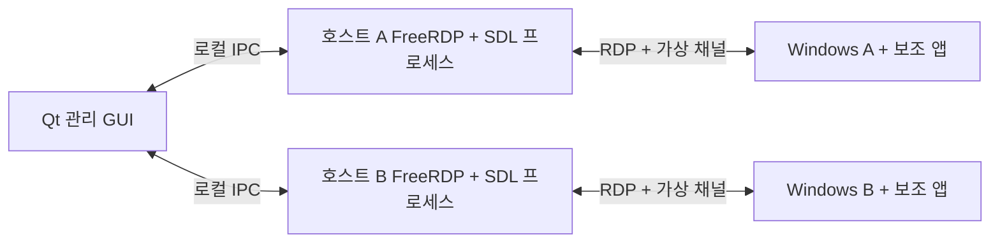

# WayWin 기획·설계

## 목표와 승인

Windows 11의 **접속한 RDP 사용자 세션**에 존재하는 창과 새 창을 Ubuntu의 개별 창으로 조작한다. 창 정지·충돌 방지, 장애 발생 시 다른 연결과 작업 보호가 최우선이다. 물리 콘솔의 동시 화면 공유는 요구하지 않는다.

2026-11-13 사용자가 이전 기획을 개발 의도로 지정하고 구현을 요청했다. 같은 세션에서 실제 Ubuntu/Windows에 지금 접근할 수 없으므로 **검증 도구와 절차 준비**를 선택했다. 실제 환경 증거가 없는 동안 0단계 진행 조건은 충족되지 않는다. 이 조건은 기능 요구 축소를 뜻하지 않는다.

## 요구사항

| ID | 첫 제품의 요구사항 |
|---|---|
| R1 | GUI 호스트 추가·수정·삭제, 접속·해제, 사용자명·인증 도메인·비밀번호, 화질·해상도 설정 |
| R2 | IP·DNS·포트·RDP 주소 입력. 서버 주소와 인증 도메인 구분 |
| R3 | 접속 전/후 창을 개별 창으로 표시. 입력·크기·최소화·복원·종료 연동 |
| R4 | 호스트별 창 목록·Windows 트레이 목록과 조작, 시작·실행 진입점 |
| R5 | 전체 데스크톱↔심리스 전환 중 같은 세션의 앱·작업 보존 |
| R6 | 동시 다중 호스트의 창·입력·클립보드·장애 격리 |
| R7 | 연결 실패·끊김·보조 앱 미설치·미지원 기능을 GUI로 설명하고 복구 제공 |

후속: 데스크톱과 선택 창의 혼합·중복 표시, Windows 원본 작업표시줄·시작 메뉴 직접 전송, 세밀한 GNOME 통합. 제외: SSH/SCP, 파일·드라이브·프린터·마이크 공유, 결제·클라우드 계정·동기화. 고해상도 다중 모니터·영상 최적화는 안정성 확보 후 검토한다. 1080p·30fps는 측정 목표이다.

## 결정과 소유자

| 결정 | 상태 / 소유자 | 근거·절충·재검토 조건 |
|---|---|---|
| Ubuntu 26.04 GNOME Wayland 우선, 이후 X11 Ubuntu, 그다음 macOS | 확정 / 사용자 | Wayland 실환경을 별도로 검증. macOS 빌드는 개발 검증일 뿐 |
| Qt 6/C++ GUI + FreeRDP/SDL 3 호스트별 프로세스 | 확정 / 사용자 | 기존 RAIL 창 처리 재사용, 프로세스 장애 격리. IPC 수명 관리 필요 |
| Windows 보조 앱 설치·정상적인 RDP 설정 변경 허용 | 확정 / 사용자 | 같은 RDP 세션의 셸 기능. 시스템 바이너리 패치나 우회는 범위 밖 |
| 여러 호스트, 선택 비밀번호 저장, 호스트별 텍스트 클립보드·재생 소리 | 확정 / 사용자 | 혼선 방지 및 로컬 키링 필요 |
| Apache-2.0, 개인 사용 검증부터 | 확정 / 사용자 | 의존성 라이선스는 별도로 유지·추적 |
| Git + 기존 GitHub origin | 확정 / 사용자 | 로컬 이력·복구·오프라인, 향후 협업. 새 저장소 생성 안 함 |
| 별도 관리 창, Dock 진입점, 가능한 환경의 트레이 아이콘 하나 | 채택 / 허용된 UI 범위 내 구현 선택 | 트레이가 없어도 모든 기능 접근 가능 |
| FreeRDP 3.33.1 초기 검증 기준 | 채택 / 기획 | 호환성 통과 버전이라는 의미 아님. 수정 최소화·별도 패치 관리 |
| 추가 스킬 없이 시작 | 확정 / 사용자 | Spec Kit·OpenSpec 미설치·미호출. 협업/변경 추적 부담 증가 시 재평가 |
| 출시일·추가 지출·호스팅 | 미정 / 사용자 | 이번 작업은 로컬 준비, 게시·푸시·유료 자원 사용 권한 없음 |

## 화면과 동작

왼쪽 호스트 목록, 오른쪽 연결 상태·설정·원격 창·트레이 목록. 원격 창 제목에 `[호스트 이름]`, 작업 목록과 같은 색상 표시선을 제공하고 전체 테두리 강조는 선택 설정으로 둔다. 시스템 테마·글꼴·배율을 따른다. 이름·상태 문구로 색상을 보완하고 키보드 탐색·명확한 포커스를 제공한다. 연결 중 취소와 다른 호스트 선택이 가능해야 한다.

시작·실행은 보조 앱의 앱 목록·실행 기능을 우선 사용하고 원본 Windows 셸은 데스크톱 모드로 접근한다. Wayland의 로컬 창 배치는 컴포지터에 맡기며 원격 입력 좌표를 별도로 변환한다. 절대 위치 지정으로 해결한다고 가정하지 않는다.

## 경계와 데이터

GUI는 설정·수명·사용자 조작·상태를 담당하고 GUI 스레드에서 네트워크·영상 처리를 하지 않는다. 세션 프로세스가 인증·영상·창·입력을 맡는다. Windows 보조 앱은 해당 사용자 세션의 앱 목록·실행·상태·셸 기능을 담당한다. 가능한 기능은 RAIL 우선. 보조 앱 통신은 기존 RDP 가상 채널을 사용하고 공개 수신 포트를 추가하지 않는다.

내부 계약은 버전·지원 기능 협상, 세션 생성/연결/해제/복구/모드 전환, 창 생성/변경/삭제, 트레이 목록/변경/조작, 보조 앱 버전/오류이다. 모든 명령·이벤트는 호스트 ID, 세션 세대 ID, 대상 ID로 범위를 한정한다. 재연결 전 이벤트는 버린다. 프로세스 응답·명령 처리 상태로 장애를 판단하며 정지 영상만으로 장애 판정하지 않는다. 일시적 단절은 제한된 재시도, 반복 충돌은 사용자 복구 선택으로 전환한다.

호스트 설정은 로컬 파일, 비밀번호는 선택 시 OS 키링이다. 키링 부재·잠금은 입력 요청으로 복구하고 평문 저장하지 않는다. 비밀번호를 인자·로그에 넣지 않는다. 인증서 실패/변경은 GUI에서 확인하고 검증을 일괄 해제하지 않는다. 호스트별 클립보드·소리를 제어하며 수신 클립보드를 다른 호스트로 자동 중계하지 않는다. 외부 분석·화면 녹화·키 입력 수집은 추가하지 않는다.

## 개발 단계와 진행 조건

0. 네이티브 Wayland RAIL 창/팝업/입력, 접속 전·후 창 발견, 가림·최소화 복원/갱신, 트레이 생성/변경/삭제/클릭/메뉴, 보조 앱 실행과 모드 전환의 작업 보존을 실증한다. 혼합·중복 표시는 조사하되 출시 차단 조건이 아니다.
1. 위 핵심 창·트레이·복구 경로가 실제 환경에서 입증된 후 호스트 관리·인증·데스크톱 모드·프로세스 격리·GUI 오류 복구를 구현한다. 도달 불가·잘못된 인증·인증서 변경·네트워크 단절을 검증한다.
2. 검증한 RAIL 경로에 창 목록·트레이·시작·실행·호스트 표시를 연결하고 다중 호스트·텍스트 클립보드·소리를 순서대로 추가한다.
3. 장시간·반복 검증 후 Ubuntu `.deb`, Windows GUI 설정을 포함한 실행 패키지를 준비한다. 버전·라이선스·재현 가능한 빌드·이전 검증 버전 복원 절차를 남긴다.

0단계의 선택 앱 성공을 모든 창 지원으로 기록하지 않는다. 핵심 경로가 불가능하거나 불안정하면 증거와 대안을 기록하고 요구 축소나 별도 영상 전송 방식을 임의로 채택하지 않는다. 실환경 접근이 없으면 검증 도구·절차를 준비하고 결과를 미검증으로 둔다.

## 최종 합격 기준

| 검증 | 합격 기준 |
|---|---|
| 장시간 | 대표 앱 5개 이상, 8시간, 충돌·교착·복구 불가능한 창 정지 없음 |
| 창 수명 | 생성·종료·최소화·복원·크기 변경 반복에 중복/유령 창·입력 혼동 없음 |
| 재연결 | 중단·복구 20회, 원격 앱 중복 실행·임의 로그아웃 없음 |
| 장애 격리 | 한 세션 정지·종료 중 GUI와 다른 호스트 조작 가능 |
| 입력·배율 | 한영 입력·조합키·팝업, 100/150/200%에서 좌표·포커스 오류 없음 |
| 다중 호스트 | 두 호스트의 창 명령·입력·클립보드 오전달 없음 |
| 자원 | 반복 후 회수, 장시간 지속 누적 없음 |
| GUI | CLI 없이 호스트 관리·설정·연결·복구·보조 앱 설정 |

단위·계약·장애 주입 테스트를 우선하고 GNOME/Windows 실증을 분리한다. 컴퓨터 사용은 검증 항목·종료 조건을 정하고 최소한 수행한다.

## 운영 기록과 자료

기준은 `docs/project-checklist.md`, 실제 작업·검증 결과는 `task.md`에 기록한다. 기준 체크는 채택 표시이며 테스트 통과 표시가 아니다. 검증한 작업 단위와 기록을 자동 로컬 커밋하고 관계없는 변경은 제외한다. 푸시·원격 커밋·게시·유료 자원 사용은 별도 권한이 있을 때만 한다.

이번 세션에서 다시 읽은 필수 지침: [개발 시작 지침 v1 revision 8](https://kickoff.jujin.dev/ai/startup/latest.md), [AI 행동 지침](https://kickoff.jujin.dev/ai/instructions.md). 카탈로그는 읽지 않았다. PC 공통 `/Users/jujin/.codex/RTK.md`에 따라 셸 명령은 `rtk`를 통해 실행한다.

설계 확인에 사용한 공식 자료: [FreeRDP 3.33.1](https://github.com/FreeRDP/FreeRDP/releases/tag/3.33.1), [SDL Wayland](https://github.com/libsdl-org/SDL/blob/main/docs/README-wayland.md), [RAIL 개요](https://learn.microsoft.com/en-us/openspecs/windows_protocols/ms-rdperp/485e6f6d-2401-4a9c-9330-46454f0c5aba), [RDP DVC](https://learn.microsoft.com/en-us/windows/win32/termserv/dynamic-virtual-channels), [Qt 트레이](https://doc.qt.io/qt-6/qsystemtrayicon.html). 규격의 기능 정의와 실제 Windows/SDL 지원을 구별한다.
