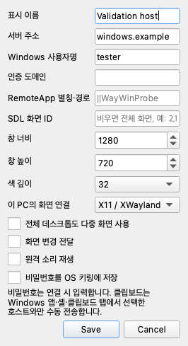

# WayWin 0.3 제품 실행과 GUI 검증

제품 기능과 실환경 검증은 별도 모듈이다. 연결·Windows 앱 실행·창/트레이·원본 셸 화면·클립보드·환경 점검·검증 기록은 모두 GUI에서 사용한다. 사용자가 Python을 실행하는 절차는 없다. 제품은 Linux의 Wayland와 X11을 대상으로 하며 GNOME·KDE·다른 데스크톱이나 WSLg라는 이유로 접속을 막지 않는다. **각 Linux 데스크톱·WSLg와 Windows의 실제 연결 호환성 검증은 아직 미실행**이다.

## 설치

테스트 묶음의 START-HERE.md를 따른다.

- Ubuntu/Debian 계열: ubuntu/WayWin-Setup.desktop의 실행을 허용하고 연다. GUI에서 관리자 인증 후 apt 패키지 설치 → 고정 FreeRDP/WayWin 빌드 → 사용자 폴더 설치가 진행된다. 최초 설치에는 인터넷과 빌드 시간이 필요하다. 패키지 목록은 Ubuntu 26.04 기준이며, 다른 버전의 저장소에 Qt 6.4 이상·SDL3·SDL3_ttf 개발 패키지가 없으면 설치가 실패하고 진단 파일을 보여준다. GNOME·KDE 또는 X11·Wayland에 따른 설치 제한은 없다. 앱 목록에 WayWin과 WayWin 제거가 생긴다. **Linux 바이너리를 미리 빌드한 패키지가 아니라 현지 빌드 설치 묶음**이다.
- Windows x64: windows/WayWin Companion.exe를 해당 사용자 세션에서 실행한다. Install + start at sign-in은 현재 사용자에게 설치하고 로그인 자동 시작을 등록한다. 닫기는 알림 영역으로 숨기며, Disable startup은 자동 시작 해제, Exit companion은 종료다.
- windows/WayWin Windows Probe.exe는 Session/PID/Instance·임시 입력·창·팝업·트레이를 비교하는 시험 앱이다.
- 다른 Linux 배포판은 아래 개발자 빌드 절차로 설치한다. macOS 실행본은 개발 GUI 확인용이며 제품 접속 대상은 Linux다.

Windows는 지원되는 Remote Desktop/RemoteApp 구성이 필요하다. 보조 앱은 에디션 제한을 우회하거나 시스템 바이너리를 수정하지 않는다. 처음에는 전체 데스크톱에 연결해 보조 앱·시험 앱을 실행한 뒤 개별 창으로 전환한다.

## 제품 사용

1. **환경·도움말**에서 배포판·데스크톱·로그인 세션과 시도할 화면 연결 방식을 확인한다. Linux와 사용 가능한 Wayland 소켓 또는 X11 DISPLAY가 사전 조건이다. DISPLAY 존재만으로 서버 접근·인증 성공을 보장하지 않으며 실제 연결 후 확인한다.
2. **호스트 추가**에서 이름·서버·사용자·인증 도메인, RemoteApp 별칭·화면 ID·크기·색 깊이·다중 화면·동적 해상도·소리를 설정한다. **이 PC의 화면 연결**은 자동 감지, Wayland, X11 / XWayland 중 선택한다. 기존 설정은 자동 감지로 읽는다. 자동 감지는 로그인 세션이 X11이면 X11을 먼저, 그 외에는 사용 가능한 Wayland를 먼저 시도한다. 두 연결이 있으면 초기화 실패 시 다른 방식도 시도한다. 명시적으로 선택한 방식은 바꾸지 않는다.
3. **연결**에서 비밀번호를 입력한다. 선택한 경우에만 OS 키링에 저장하고 평문 대체는 하지 않는다. 인증서 창에서 이름·지문을 확인한다. 기본 키 동작은 취소이며 인증서 저장소는 호스트마다 분리된다.
4. **연결** 탭에서 원격 창 제목과 원본 트레이 아이콘을 선택해 활성화·최소화·복원·닫기·아이콘 클릭·메뉴를 요청한다. 서버가 제목/그림을 제공하지 않으면 ID를 표시한다. 호스트 이름·색상으로 대상을 구분한다.
5. **Windows 앱·셸·클립보드 → 앱 목록 새로고침 → 선택 앱 실행**으로 Windows 시작 메뉴에 등록된 앱을 실행한다. 보조 앱이 열거한 앱 ID만 실행 대상으로 허용한다.
6. **시작 메뉴 / 입력기 설정 / 빠른 설정 / IME 후보 창**으로 해당 Windows 원본 UI를 별도 창에 표시한다. 마우스·휠·키보드·한글 확정 문자열을 같은 세션으로 전달한다. 후보 창은 Windows 앱에서 실제 후보 창을 먼저 연다. 닫기는 해당 셸에 닫기/Escape를 요청한다.
7. **Windows에서 읽기 / Windows로 보내기**로 텍스트 클립보드를 수동 교환한다. 이 PC의 가져오기/복사도 버튼 동작이다. 최대 UTF-8 64 KiB이며 호스트 간 자동 중계와 내용 저장은 없다.
8. 네트워크 단절은 1·2·4·8·16초, ±20% 편차로 최대 5회 재시도한다. 시도별 9초 제한을 적용한다. 마지막 화면을 보존하고 500ms 후 어둡게 표시하며 원격 입력을 버린다. **즉시 재시도 / 자동 재시도 중단 / 연결 해제**를 사용할 수 있다. 네트워크 복구·절전 해제 신호는 대기를 건너뛴다. 인증/계정/로그오프/인증서 오류를 계속 자동 재시도하지 않는다.
9. **모드 전환**은 같은 호스트에 다른 모드로 재접속하며 앱 실행을 반복하지 않는다. 보조 앱 세션 ID/인스턴스 변경을 알린다. 실제 작업 보존은 Windows 정책에 따라 직접 확인한다.
10. 엔진 충돌은 원격 앱 실행 없이 한 번 복구한다. 인증은 키링 또는 입력창으로 받으며 반복 충돌은 멈춘다. 비밀번호 변경은 **검증 도구 → 저장 비밀번호 삭제** 후 다시 연결한다.

화면 연결 선택 GUI (macOS의 offscreen 테스트에서 촬영한 가상 호스트 설정이며 Linux 연결 결과가 아님):

## 원본 셸 화면의 범위

셸 창은 같은 RDP의 WayWin DVC로 전송한다. 추가 수신 포트는 없다. 현재 Windows 세션의 승인된 셸 창을 PrintWindow·WIC JPEG로 캡처하며 최대 4회/초, 너비 1600px이다. 입력은 원래 창 크기에 대응한다. 일반 RDP/RAIL은 별도 기본 화면 전송 경로다.

Windows 빌드·정책·DWM에 따라 검색·캡처·포커스·입력이 거부될 수 있다. 시간 초과와 접근 실패는 GUI에서 표시한다. 검은 화면이나 입력 실패는 P09 실패로 기록한다. URI 호출·캡처 API 성공만으로 원본 UI 호환성을 합격 처리하지 않는다. 실제 Windows 셸 호환성은 이번 macOS 환경에서 확인하지 못했다.

## 제품 안에서 실환경 검증

P01–P10, 셸 3종, M01–M06의 절차·종료 조건을 읽고 관측·증거·결과를 기록한다. **현재 실행을 선택 검증 항목에 첨부**로 UUID를 붙이며 실제로 관측한 SDL 드라이버(wayland 또는 x11)를 기록한다. 드라이버를 관측하지 못한 실행을 첨부하면 이전 드라이버 필드를 비운다. **검증 도구**에서 선택 호스트 일시 정지·재개·강제 종료로 격리를 확인한다. 호스트별 자동 저장·가져오기·내보내기·완결성 검사를 제공하며 수동 기록을 자동 합격으로 바꾸지 않는다.

제품 보고서는 schema 3이며 배포판, 데스크톱·컴포지터, 로그인 세션, 실기기/VM/WSLg, 실제 SDL 드라이버를 구분한다. 기존 schema 2 보고서도 가져오며 Ubuntu/GNOME 기록과 관측·증거를 보존한다. 과거에 기록하지 않은 실행 환경은 직접 채워야 한다. 다른 환경으로 바꾸기 전에 기존 보고서를 내보내고 별도 호스트 항목으로 새 검증을 시작한다. Wayland 세션 안에서 x11을 선택한 결과는 XWayland 결과로 기록한다.

WSL2 + WSLg에서도 전체 연결 흐름을 시도할 수 있다. WSLg의 Wayland 소켓이나 DISPLAY가 필요하며 로그인 세션·데스크톱 이름이 없다는 이유로 차단하지 않는다. GUI 설치에는 zenity, pkexec와 사용자 세션의 관리자 인증 에이전트가 필요하다. 이 구성이나 개발 패키지가 없는 WSL에서는 먼저 구성하거나 개발자 빌드 절차를 사용한다. WSLg 결과를 GNOME/Mutter 또는 KDE/KWin의 호환성 결과로 확대하지 않는다. VM 역시 GPU·물리 모니터·절전 동작은 실기기와 별도로 기록한다.

8시간/5앱, 복구 20회, 실제 트레이·원본 셸·한글 입력·멀티모니터·키링·인증서 변경은 해당 Linux/Windows 조합에서 확인한다. 기존 Python 프로브와 schema 2 예제는 원래 GNOME Wayland 실현 가능성 비교용으로 유지하며 제품 접속 조건이나 schema 3 보고서 판정에는 사용하지 않는다.

## 구조와 데이터

| 경로 | 역할 |
|---|---|
| app/core.*, app/window.* | 설정·호스트 GUI·인증·키링·환경·엔진 무결성 |
| app/session.* | 호스트별 세션·비밀번호 파이프·감시·복구·일시적 UI 메시지 |
| app/companion.* | 앱·셸·클립보드 GUI, 별도 셸 화면 프로세스 |
| app/validation.* | 제품 구현과 별도의 환경 검증·관측 기록 |
| runtime/, 제품 FreeRDP 패치 | DVC·SDL 주 스레드 명령 큐·RAIL 제목/이미지·버전별 트레이 동작·창 보존 재연결 |
| windows/companion/, protocol/ | Windows 설치 GUI·DVC 서버·앱 목록·셸·클립보드·버전 2 계약 |
| windows/probe/, tools/probe.py | 기존 비교용 시험 도구. 제품 실행 의존성 없음 |
| cmake/FreeRDPProduct.cmake | 프로브와 분리한 제품 빌드 프로필 |

네트워크와 원격 화면은 호스트별 프로세스에서 처리한다. 셸 JPEG 디코딩/표시도 관리 GUI와 별도 프로세스다. 부모 파이프 EOF 시 종료하며 Linux 자식은 parent-death signal을 적용한다. 세션 그룹은 3초 유예 후 회수한다. setsid로 이탈한 모든 후손에 대한 cgroup 보장은 기존 별도 실환경 과제로 유지한다.

앱 로컬 데이터에 호스트 설정·실행 UUID별 기록·호스트별 검증 JSON·인증서를 저장한다. 폴더 0700, 파일 0600, 원자적 교체와 단일 관리자 잠금을 사용한다. 비밀번호는 인자·환경·기록에 넣지 않는다. 제목·아이콘·셸 이미지·클립보드는 메모리의 일시적 메시지이며 진단 파일에 기록하지 않는다. 사용자 관측 내용은 그대로 저장한다. 자동 업로드는 없다.

## 개발자 빌드

apt 의존성은 packaging/install-linux.sh에 있다. 다른 배포판도 Qt 6.4 이상·QtKeychain·SDL3·SDL3_ttf와 FreeRDP 의존성을 설치한다. 제품 엔진은 Wayland와 X11 네이티브 RAIL 보조 코드를 모두 포함해야 하므로 Wayland 개발 패키지·프로토콜·scanner 및 X11 개발 패키지가 필요하다. 실제 데스크톱 세션은 둘 중 하나만 있어도 된다. 이전 Linux 엔진에 두 방식의 빌드 정보가 없으면 재빌드를 안내한다.

~~~sh
cmake -S . -B build/product -G Ninja -DWAYWIN_BUILD_RUNTIME=ON
cmake --build build/product --parallel 4
ctest --test-dir build/product --output-on-failure
cmake --install build/product --prefix "$HOME/.local/waywin"
cpack --config build/product/CPackConfig.cmake
~~~

Windows Visual Studio C++ 환경:

~~~sh
cmake -S . -B build/windows-native -A x64 -DBUILD_TESTING=OFF
cmake --build build/windows-native --config Release
~~~

Windows x64는 MinGW 교차 컴파일도 지원한다. MSVC·Ubuntu 실제 빌드는 별도 확인이 필요하다. macOS는 Qt 6/QtKeychain/SDL3/SDL3_ttf/CMake/Ninja와 FreeRDP 의존성을 사용한다.

FreeRDP 커밋을 고정하고 관측·제품 패치를 순서대로 적용한다. 패치 변경 후에는 새 빌드 디렉터리를 사용한다. 개발자는 runtime/와 검토한 checkout을 동기화한 뒤 tools/update_product_patch.py로 패치·lockfile을 재생성한다. 원본+프로브+제품 패치의 바이트 일치까지 확인한 checkout에만 검토 표식을 갱신한다. Python은 개발 테스트·패치 제작에서만 사용한다.

기본 프로필은 소프트웨어 그래픽과 암호 인증이다. FFmpeg/OpenH264·Kerberos·파일/드라이브/마이크/프린터 공유는 기본 빌드에 포함하지 않는다. 1080p/30fps는 실환경 측정 목표이며 검증한 성능 수치가 아니다.

API 근거: [DVC 서버](https://learn.microsoft.com/en-us/windows/win32/termserv/dvc-server-apis), [WTS 조각 읽기](https://learn.microsoft.com/en-us/windows/win32/api/wtsapi32/nf-wtsapi32-wtsvirtualchannelread), [RAIL 알림 이벤트](https://learn.microsoft.com/en-us/openspecs/windows_protocols/ms-rdperp/cce43d39-cacc-4d28-aa5b-3af736a89924).
